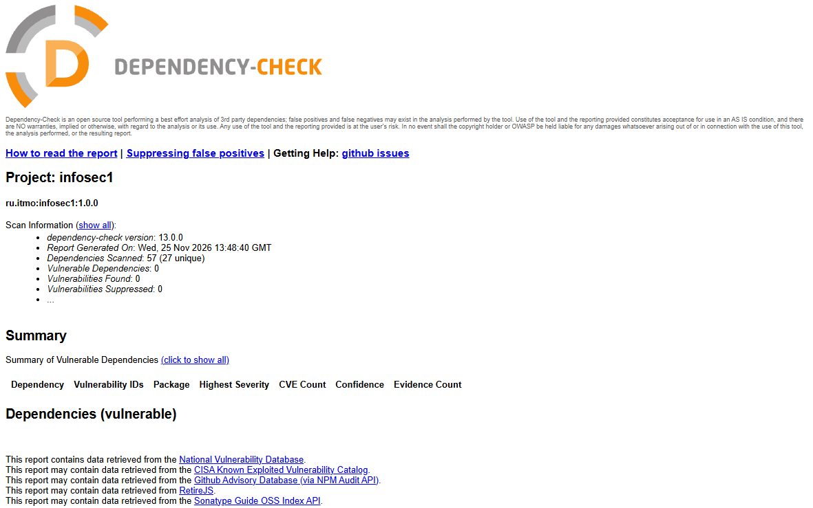
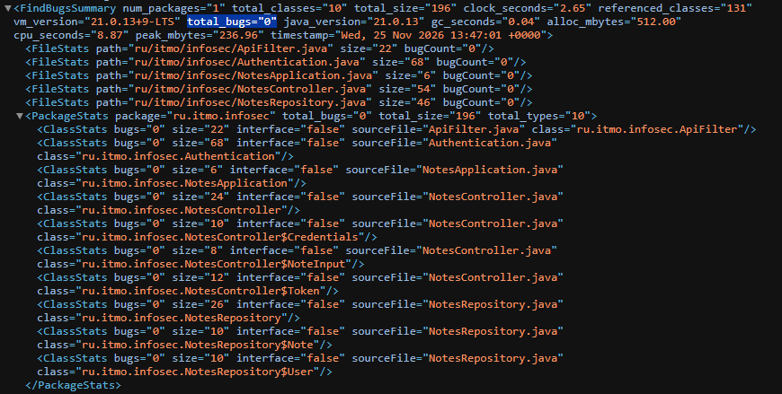

# Информационная безопасность

## Лабораторная работа № 1

Разработка защищённого REST API с интеграцией в CI/CD.

### Стек

- Java 21 / Spring Boot
- Spring JDBC / H2
- Maven

### Запуск

```powershell
$key = New-Object byte[] 32
$rng = [Security.Cryptography.RandomNumberGenerator]::Create()
$rng.GetBytes($key)
$rng.Dispose()
$env:JWT_SECRET = [BitConverter]::ToString($key).Replace('-', '')
$env:DEMO_LOGIN = 'student'
$env:DEMO_PASSWORD = 'Lab1-demo-2026!'
$env:DB_URL = 'jdbc:h2:file:./var/readme-demo'
$env:PORT = '8080'

mvn clean package
java -jar target/infosec1-1.0.0.jar
```

API доступен на `http://127.0.0.1:8080`. При первом запуске создаются демонстрационная база `var/readme-demo.mv.db` и пользователь `student` с указанным учебным паролем.

### Описание API

**`POST /auth/login`** принимает логин и пароль. При успешном входе возвращает `200 OK` и JWT в поле `accessToken`. При неверных данных возвращает `401 Unauthorized`.

```json
{
  "login": "student",
  "password": "Lab1-demo-2026!"
}
```

**`POST /api/data`** создаёт заметку и возвращает её с кодом `201 Created`.

```json
{
  "text": "A & B <draft>"
}
```

**`GET /api/data`** возвращает `200 OK` и до 100 заметок текущего пользователя, начиная с новых.

Оба запроса к `/api/data` требуют заголовок `Authorization: Bearer <JWT>`. Без действительного токена сервер возвращает `401 Unauthorized`. Для POST укажите `Content-Type: application/json`.

### Примеры через curl

```powershell
$base = 'http://127.0.0.1:8080'
$dataUrl = "$base/api/data"
$json = @('--noproxy', '127.0.0.1', '-H', 'Content-Type: application/json')

# Без токена - 401 Unauthorized
curl.exe --noproxy 127.0.0.1 -i $dataUrl

# Вход с неверным паролем - 401 Unauthorized
$wrong = '{"login":"student","password":"wrong-password"}'
$wrong | curl.exe @json -i --data-binary '@-' "$base/auth/login"

# Вход с учебным паролем - 200 OK
$credentials = '{"login":"student","password":"Lab1-demo-2026!"}'
$login = $credentials | curl.exe @json -fsS --data-binary '@-' "$base/auth/login"
if ($LASTEXITCODE -ne 0) { throw 'Не удалось войти. Проверьте запуск API.' }
$session = $login | ConvertFrom-Json
$auth = "Authorization: Bearer $($session.accessToken)"
"Срок действия JWT: $($session.expiresIn) секунд"

# Создание заметки - 201 Created
'{"text":"A & B <draft>"}' | curl.exe @json -i -H $auth --data-binary '@-' $dataUrl

# Чтение своих заметок — 200 OK
curl.exe --noproxy 127.0.0.1 -i -H $auth $dataUrl
```

Пример ответа на создание первой заметки в новой базе:

```json
{
  "id": 1,
  "text": "A &amp; B &lt;draft&gt;"
}
```

### Реализованные меры защиты

- **SQLi.** `NotesRepository` передаёт логин и идентификатор владельца как параметры JDBC. При вставке заметки `SimpleJdbcInsert` получает значения отдельно, а имена таблицы и столбцов заданы в коде.

```java
jdbc.query("SELECT id, password_hash FROM app_users WHERE login = ?",
    (rs, row) -> new User(rs.getLong("id"), rs.getString("password_hash")), login)
```

- **XSS.** Перед возвратом заметки `NotesController` экранирует её текст через `HtmlUtils.htmlEscape()`. В базе хранится исходная строка.

```java
private static NotesRepository.Note publicNote(NotesRepository.Note note) {
    return new NotesRepository.Note(
        note.id(), HtmlUtils.htmlEscape(note.text(), StandardCharsets.UTF_8.name()));
}
```

- **Пароли.** Сервер хранит BCrypt-хэши со случайной солью и фактором сложности 12.
- **JWT.** Сервер выдаёт токен HS256 на 15 минут. Перед доступом к заметкам `ApiFilter` проверяет подпись, издателя, аудиторию и срок действия. SQL-запрос использует идентификатор владельца из проверенного токена.

### Отчёты из pipeline

**Dependency-Check (SCA).** Проверено 27 зависимостей, найдено 0 уязвимостей.



**SpotBugs (SAST).** Проверка прошла. Все 6 интеграционных тестов прошли.



### Последний успешный запуск

[GitHub Actions — Java security checks](https://github.com/ahsokatyan/infosec1/actions/runs/45627045149)
